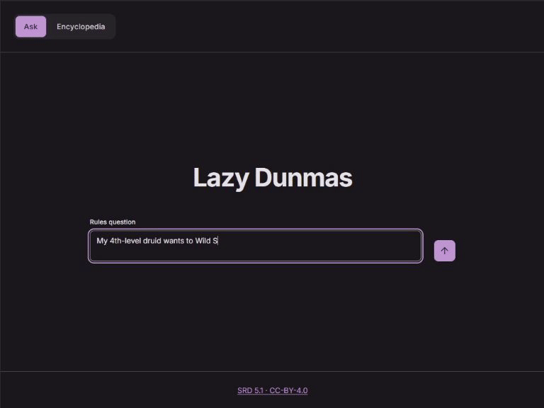
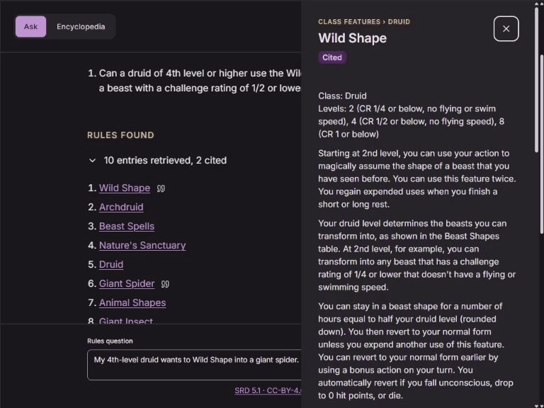
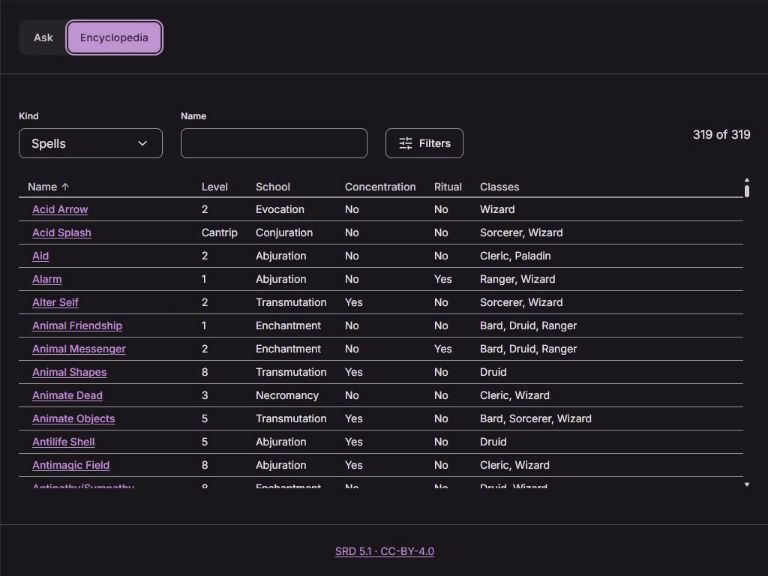

# Lazy Dunmas

Rules disputes at a D&D table, answered by a model from the SRD 5.1, every ruling citing the sections it rests on, plus an evaluation harness that measures retrieval and answers separately against a gold set.

## What it does

### Ask a rules dispute



Ask one rules question. A model checks that it is about the rules, splits it into the rules it turns on, retrieves ten SRD entries for them, and rules from those alone: a verdict, an ambiguity flag, an explanation and the entries it cites. Each phase streams to the screen as it lands.

### Citations and the source panel



The explanation links every entry it names, the ruling lists the ones it cites, and the ten it was handed are a click away. Each opens beside the ruling as the encyclopedia shows it: formatted, or as the text the model was handed, a tab away.

### The encyclopedia



The SRD's spells, magic items, monsters, weapons and armor, races, conditions and weapon properties, in a table to search, filter and sort. A row opens in the same panel. It reads the data files in the browser, so browsing needs neither the server nor a model.

## Measured

An evaluation harness scores retrieval and rulings separately, on a held-out test split of 67 gold items, with a judge checked against hand grades before its scores were counted. Measured with `qwen3.5:9b` at level 3, the pipeline the screen runs, the verdict agrees with gold on 44 of 55; Opus 5.5 driving the tool loop, the ceiling, on 53; and a floor that answers "no" to every item on 27. Each row is one draw; [the results](docs/results.md) set out every stage and model, and how far the 9b's draws move.

## Running it

You need Python 3.12 or later, Node 20.19 or 22.12 or later, and Ollama.

Pull a chat model and an embedding model of your choice through Ollama.

The published results were measured with `qwen3.5:9b` and `nomic-embed-text`. A chat model that fails `scripts/evals/check_key_order.py` writes its verdict before its reasoning, so its rulings will not match what was measured.

Install the server and the screen, from the repository root:

```
python -m venv .venv
.venv/Scripts/python -m pip install -e ".[dev]"
cd web
npm install
```

On macOS or Linux, the venv's Python is `.venv/bin/python` rather than `.venv/Scripts/python`.

Copy `.env.example` to `.env` and fill it in: the two models' names, as `ollama list` shows them, and any query and document prefixes your embedding model's card asks for. The server will not start without both models.

Then, each in a terminal of its own, with Ollama running:

```
.venv/Scripts/python -m uvicorn rules_attorney.app.server:app
```

```
cd web
npm run dev
```

The server embeds the corpus once at startup, then serves on port 8000. The screen is at `http://localhost:5173`, and forwards questions to the server. The encyclopedia needs only the second terminal: it reads the data files in the browser.

## Docs

- [How it works](docs/how-it-works.md): the run phase by phase, the models, the server, the screen and the corpus.
- [Results](docs/results.md): the retrieval stages and the models, scored on the held-out test split.
- [Evaluation](docs/evaluation.md): reproducing the results, and measuring your own model.
- [Development](docs/development.md): the checks.

This work includes material taken from the System Reference Document 5.1 ("SRD 5.1") by Wizards of the Coast LLC and available at
https://dnd.wizards.com/resources/systems-reference-document. The SRD 5.1 is licensed under the Creative Commons Attribution 4.0 International License available at https://creativecommons.org/licenses/by/4.0/legalcode.
